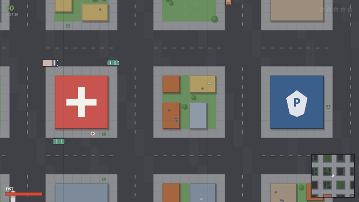
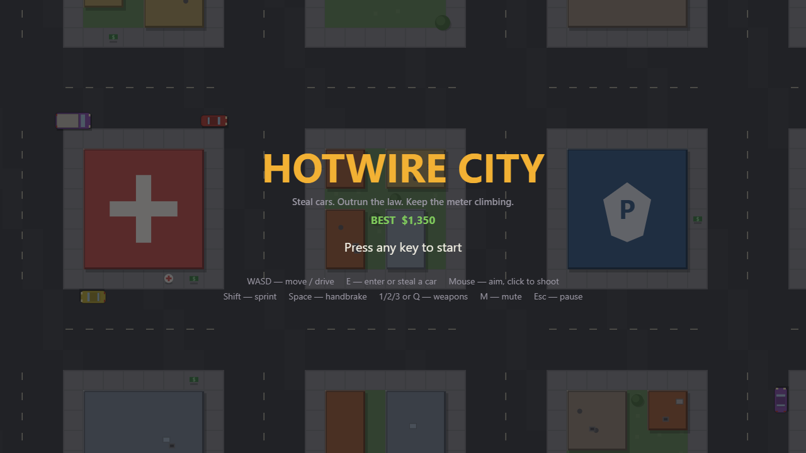
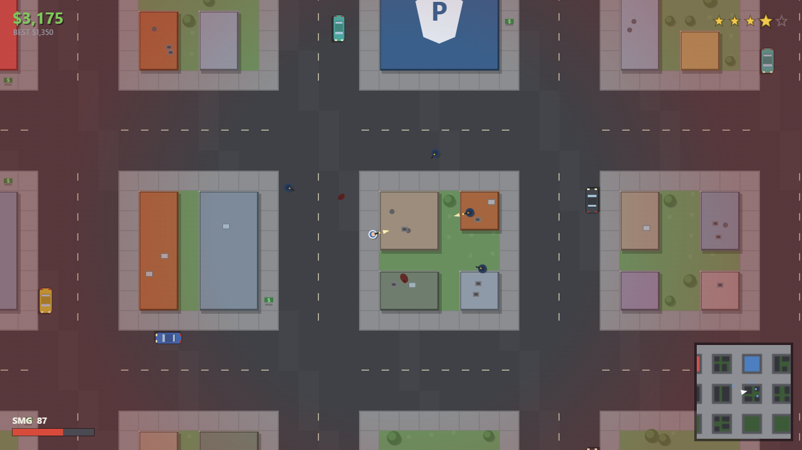

# Hotwire City

A top-down 2D car-theft and police-chase game for the browser, written in plain JavaScript and Canvas 2D.

**Play it: <https://appleweiping.github.io/hotwire-city/>** (desktop browser, keyboard and mouse)



This is the prototype I wrote before
[Overdrive City](https://github.com/appleweiping/overdrive-city). I wanted to
find out whether a small open-city game with traffic, pedestrians and a police
response could work with no engine and no assets, so I built it top-down in
Canvas 2D first. Overdrive City reuses the same ideas (tile-map city, one-
parameter drift, heat-based wanted level) in 3D and adds generated jobs and a
day/night cycle. If you want the fuller game, play that one; this one is
smaller and quicker to read.

## Run it locally

```bash
git clone https://github.com/appleweiping/hotwire-city.git
cd hotwire-city
python -m http.server 8000
# open http://localhost:8000 and press any key
```

Browsers block ES modules on `file://`, so it needs a static server. There is
nothing to install and nothing to build. Phones get a notice instead of the
game, because there are no touch controls.

## Controls

| Key | On foot | Driving |
|---|---|---|
| `W` `A` `S` `D` | Move | Throttle, steer, brake and reverse |
| Mouse | Aim, click to shoot | |
| `Shift` | Sprint | |
| `Space` | | Handbrake (drift) |
| `E` or `Enter` | Get into or steal a car | Get out |
| `1` `2` `3` or `Q` | Pick or cycle weapon | |
| `M` | Mute | Mute |
| `Esc` or `P` | Pause | Pause |

## What happens

You start on foot in a city full of pedestrians, traffic and parked cars.
Steal a car, pick up street cash, and see how long you last. Crimes (shooting,
carjacking, hitting people, attacking officers) raise your heat; stars appear
at 10, 30, 60, 100 and 150 heat. Officers come on foot first, then in cars,
which start ramming at three stars, and at five stars the police set up
roadblocks ahead of you. Heat only drains after 8 seconds with no new crime
and no officer able to see you.

Dying shows **FLATLINED**, costs 30% of your cash and puts you outside the
hospital; being arrested shows **CUFFED**, costs 20% plus your guns and puts
you outside the police station. Surviving at three stars or more pays $100
every 30 seconds. There is no game over: your best cash total is saved in the
browser.

## How it's built

- **Fixed 60 Hz simulation** (`src/game.js`) with an accumulator and a 250 ms frame cap, drawn into a fixed 1280×720 logical viewport that is letterboxed to the window, so everyone sees the same amount of city.
- **The map is the spatial index.** `src/world/citymap.js` builds a 92 × 92 tile city (32 px tiles) from a fixed seed into a `Uint8Array`; wall collision, line of sight (a tile DDA walk) and lane directions are direct array reads. Moving entities use a spatial hash (`src/systems/physics.js`).
- **Drift is one parameter.** Car velocity is split into forward and sideways parts and the sideways part decays as `exp(−grip·dt)`; the handbrake lowers `grip` (`src/entities/vehicle.js`).
- **Static ground is cached.** The city is pre-rendered into 512 px offscreen canvases, and skid marks are painted into those chunks once instead of being redrawn every frame (`src/renderer.js`).
- **Police AI reacts a tick late.** Events raised during a tick are only visible to AI on the next tick, so officers cannot react to a shot in the same frame it is fired; the wanted level caps heat gain at 40 per second (`src/systems/wanted.js`, `src/systems/police.js`).

Every gameplay number lives in [`src/config.js`](src/config.js) and is
explained in [docs/DESIGN.md](docs/DESIGN.md).

| Title screen | Four stars downtown |
|---|---|
|  |  |

## Limitations

- Desktop only; no touch or gamepad support.
- No missions or story: it is a sandbox with a cash score. The jobs live in Overdrive City.
- Sprites are simple vector shapes and the sound is synthesized beeps and noise.

## License

MIT, see [LICENSE](LICENSE). Inspired by the top-down crime games of the late
1990s; it uses none of their code, art, names or audio and is not affiliated
with any publisher.

中文说明见 [README.zh-CN.md](README.zh-CN.md)。
