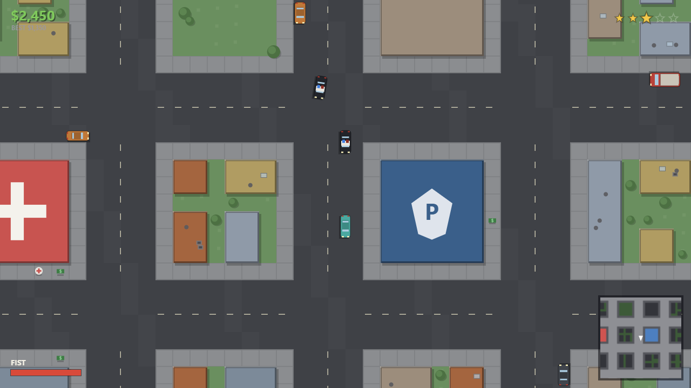

# HOTWIRE CITY（热线之城）

**零依赖的俯视角开放城市犯罪游戏，灵感来自经典 GTA 1/2。**
偷车、甩开警察、让金钱数字不断攀升。

**[▶ 在浏览器里直接玩](https://appleweiping.github.io/hotwire-city/)** —— 无需安装、无需构建，桌面端键鼠操作。

[English README](README.md)



## 这是什么？

一封写给俯视角 GTA 时代的情书，同时是一次"极简主义"的技术练习：

- **零依赖。** 没有引擎、没有框架、没有 npm、没有构建步骤，纯 ES modules + Canvas 2D。
- **零素材。** 所有画面都是程序化矢量绘制，所有音效都由 Web Audio API 实时合成——仓库里没有一张图片、没有一个音频文件。
- **一座确定性的城市。** 92×92 tile 由固定种子生成，每个玩家走的都是同一条街。

## 玩法循环

在有行人和车流的城市里游荡。按 `E` 偷一辆车。惹是生非。看着通缉星升起——先是巡警，然后是警车、冲撞拦截、直至路障。躲开视线蛰伏可以降星；或者拥抱混乱：**3 星以上每存活 30 秒奖励 $100**。死亡损失 30% 现金，被捕损失 20% 外加没收武器。没有 Game Over——最高现金就是你的分数。

## 操作

| 按键 | 步行 | 驾驶 |
|---|---|---|
| `W A S D` | 自由角度移动 | 油门 / 转向 / 刹车·倒车 |
| 鼠标 | 瞄准（点击射击） | — |
| `Shift` | 冲刺 | — |
| `Space` | — | 手刹（漂移！） |
| `E` / `Enter` | 上车 / 抢车 | 下车 |
| `1 / 2 / 3` 或 `Q` | 选择 / 切换武器 | — |
| `M` | 静音 | 静音 |
| `Esc` / `P` | 暂停 | 暂停 |

## 本地运行

浏览器不允许在 `file://` 协议下加载 ES modules，所以需要一个静态服务器：

```bash
git clone https://github.com/appleweiping/hotwire-city.git
cd hotwire-city
python -m http.server 8000
# 打开 http://localhost:8000
```

任何静态服务器都可以（`npx serve`、VS Code Live Server 等）。无需安装依赖、无需构建。

## 技术亮点

约 4000 行原生 JavaScript，值得一看的部分：

- **固定 60Hz 时间步长** + 累加器——144Hz 高刷屏和低配笔记本上物理表现完全一致。
- **固定 1280×720 逻辑视口**，等比缩放适配窗口——所有玩家看到的世界范围一致，刷怪环带永远在屏幕外。
- **地图即空间索引**：tile 存在 `Uint8Array` 里，墙体碰撞、视线检测（tile DDA）、车道方向全部是 O(1) 查询。
- **一个参数的漂移系统**：车速分解为纵向/侧向分量，侧向按 `exp(−grip·dt)` 衰减，手刹只是临时调低 `grip`。
- **Hitscan 射击**——没有子弹实体，只有射线和单帧曳光。
- **Chunk 地面缓存**：静态城市预渲染进 512px 离屏画布；血迹和胎痕永久画入 chunk，每帧零开销。
- **基于热度的通缉系统**：增益限速（40/s）、视线门控衰减、追捕单位豁免回收——你惹来的警察不会自己消失。

完整机制与调参手册：[docs/DESIGN.md](docs/DESIGN.md)（英文）。

## 截图

| | |
|---|---|
|  |  |

## 路线图

- 触屏操作（目前仅支持桌面端，手机会显示友好提示页）
- 昼夜循环与车灯
- 任务生成器（送货、追逐、暗杀）
- 高刷屏渲染插值

## 许可证

[MIT](LICENSE)。本项目与 Rockstar Games / Take-Two Interactive 无关，"GTA" 仅作为玩法类型的灵感来源被提及。
